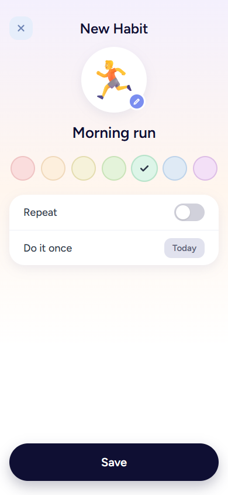
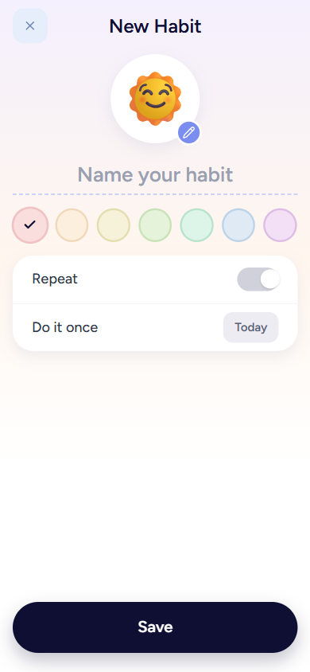
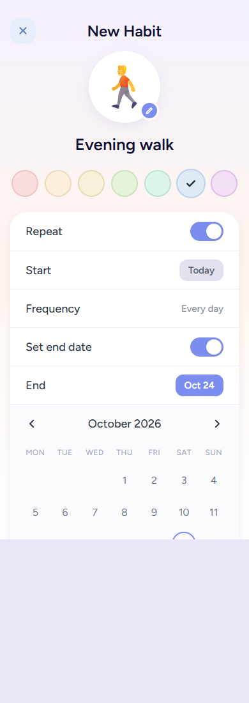
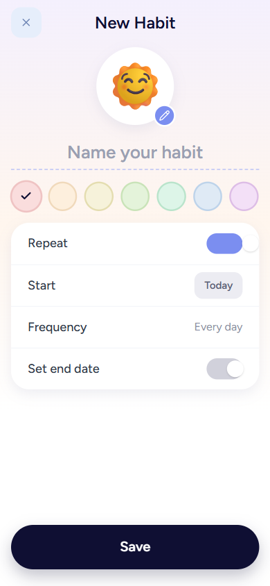

# BUG: Toggle knob is mispositioned (does not match design) on the New Habit screen

| Field | Value |
|---|---|
| Bug ID | _(to be assigned)_ |
| Date reported | 2026-10-17 |
| Severity | **Medium** – functional but visibly broken UI on a primary flow; state is hard to read |
| Priority | High (affects US-01, the product entry point) |
| Reproducibility | **Always (4/4 observations, both toggles, both states)** – Confirmed |
| Environment | Local dev build, Vite `http://localhost:5173` + API `http://localhost:5171`, Playwright Chromium, viewport 390×844 |
| Module | Frontend – shared component [Toggle.tsx](../src/frontend/src/components/ui/Toggle.tsx), used by [ScheduleCard.tsx](../src/frontend/src/features/habits/components/ScheduleCard.tsx) ("Repeat", "Set end date") |
| Requirement | US-01 AC1 / AC2 UI tables – "52×30px pill toggle, gray when off and accent when on"; [DESIGN.md](../working-artifacts/design-system/habit-tracker/DESIGN.md) – *Toggle: 52 × 30 px pill, `#D1D1DB` off and accent on, 24 px white knob with a small shadow, 0.2 s slide* |

## Summary
On the New Habit screen both switches ("Repeat" and "Set end date") draw the white knob on the wrong side. The knob sits at the right end when the switch is **off**, and sticks out of the track (to the right) when the switch is **on**. The design shows the knob on the left when off and on the right, inside the track, when on.

## Steps to reproduce
1. Open `http://localhost:5173` at a mobile viewport (390×844).
2. Tap the **Add a habit** (+) button to open **New Habit** (`/habits/new`).
3. Observe the **Repeat** switch (off by default).
4. Tap **Repeat** to turn it on. The **Set end date** switch appears (off).
5. Observe both switches.

## Expected result (design)
| State | Track | Knob |
|---|---|---|
| Off | 52×30, `#D1D1DB` | 24px white circle, **left**, 3px inset from the left edge (3px left / 25px right gap) |
| On | 52×30, accent `#7B8EF0` | 24px white circle, **right**, 3px inset from the right edge (25px left / 3px right gap) |

Mockups: [AC1 (off)](./evidence/BUG-Toggle-expected-off-AC1.png), [AC2 (on)](./evidence/BUG-Toggle-expected-on-AC2.png).

## Actual result
| State | Measured knob offset from track left / right | Observation |
|---|---|---|
| Off | **29px / -1px** (expected 3 / 25) | Knob is on the right and overflows the track by 1px, so it looks "on" even though the track is gray |
| On | **51px / -23px** (expected 25 / 3) | Knob is almost entirely **outside** the track, to the right; track looks like a blue bar with a detached white circle |

Track size (52×30), track colors (off `rgb(209,209,219)`, on `rgb(123,142,240)`), knob size (24×24), knob colour and shadow all match the design. **Only the knob's horizontal position is wrong.**

Evidence: [actual off](./evidence/BUG-Toggle-actual-off.png), [actual on](./evidence/BUG-Toggle-actual-on.png).

| Expected – off | Actual – off | Expected – on | Actual – on |
|---|---|---|---|
|  |  |  |  |

## Evidence quality
Strong: live reproduction with computed styles and bounding-box measurements, plus screenshots compared against the story's mockups. Not tested: other browsers/devices (Safari, Firefox, real device); behavior is expected to be the same because the cause is CSS layout, not engine-specific.

## Suspected root cause (confidence: High)
In [Toggle.tsx](../src/frontend/src/components/ui/Toggle.tsx) the knob `` is `absolute` and has `top-[3px]` but **no `left`/`inset-x` value**. Its horizontal start is therefore the browser's static position inside the `<button>`, and buttons centre their content (`text-align: center`). Measured computed style: `left: 26px` (not `0`), `translate: 3px` (off) → knob lands at 29px. The `translate-x-[3px]` / `translate-x-[25px]` values are correct only if the knob starts at `left: 0`; they are being added on top of the 26px offset.

Suggested direction (for the developer to decide): anchor the knob with `left-0` (so the existing 3px / 25px translations produce 3px and 25px offsets). Keep the 0.2 s slide (`transition-transform`) from DESIGN.md. No other changes appear necessary.

## Impact
- Visual defect on both toggles in US-01 (AC1, AC2, and any AC that shows Repeat / Set end date: AC6, AC8–AC11 screens).
- Usability: on/off state is ambiguous, especially off (white knob on the right on a gray track reads as "on").
- Violates the design-system contract for the Toggle component, so any future screen reusing `Toggle` inherits the defect.
- Functionality is **not** affected: `role="switch"`, `aria-checked`, and the Repeat / End-date logic work (the existing component tests query by role/name and don't check position, which is why they didn't catch it).

## Assumptions
- The mockups in `working-artifacts/mockup-wireframe/habit-tracker/US-01-create-and-schedule-habit/` are the approved design.
- The reporter's "toggle appearance not aligned with the design" refers to this knob placement; no other toggle differences were found (size, colors, shadow all match).

## Open questions
- None blocking. Optionally confirm whether the defect also appears on a real device/Safari.

## Next actions
1. **Developer:** fix knob anchoring in `Toggle.tsx` (see suspected root cause).
2. **Fix validation (Test):** on `/habits/new` at 390×844, verify measured knob offsets are **off = 3px left / 25px right** and **on = 25px left / 3px right** for both "Repeat" and "Set end date", the knob stays inside the track in all states, the slide animates (~0.2 s), and screenshots match AC1 and AC2 mockups.
3. **Regression:** re-check US-01 AC1, AC2, AC6 (end-date toggle flow), the existing `NewHabitForm` tests (switch role/name still operable), and keyboard/focus toggle behavior.
4. **Test gap (optional follow-up):** consider an automated visual or bounding-box check for the knob position, since role-based unit tests can't detect layout defects.
